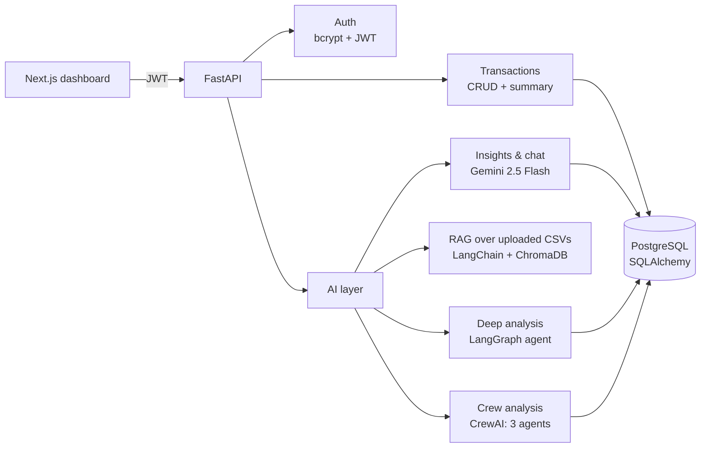

# Finance Tracker API

An AI-powered personal finance backend. Users track income and expenses through a secure REST API, then ask questions about their money in plain English. The same data is analysed by three different LLM approaches, so the project doubles as a side-by-side comparison of **RAG**, a **LangGraph state-machine agent**, and a **CrewAI multi-agent crew**.

**Frontend:** [finance-dashboard](https://github.com/kritagyasuryavanshi/finance-dashboard) (Next.js 16 + TypeScript)

## Architecture



## What it does

| Area | Details |
|---|---|
| **Auth** | Signup / login with bcrypt-hashed passwords, 24h JWT access tokens, `/auth/me` |
| **Transactions** | Create, list, filter by type, delete, and summarise income/expense/balance. Every query is scoped to the logged-in user |
| **AI insights & chat** | Gemini reads only the logged-in user's transactions and answers questions or gives spending advice, with chat history |
| **RAG** | Upload a CSV statement → chunked (1000 chars, 200 overlap) → embedded with `gemini-embedding-001` → stored in ChromaDB → ask questions with retrieved context |
| **Hybrid search** | Combines vector similarity with keyword scoring and re-ranks the merged results |
| **LangGraph agent** | A state machine: fetch data → analyse spending → score financial health → **branch** to a positive report or an alert report → format output |
| **CrewAI crew** | Three role-based agents (data analyst, financial advisor, report writer) with custom tools for category totals and pattern detection, run as a sequential crew |

## Tech stack

- **API:** Python 3.13, FastAPI, Pydantic v2, Uvicorn
- **Data:** SQLAlchemy 2, PostgreSQL (SQLite for tests)
- **Auth:** python-jose (JWT), passlib + bcrypt
- **LLMs & agents:** Google Gemini 2.5 Flash, LangChain, LangGraph, CrewAI
- **Retrieval:** ChromaDB, Gemini embeddings
- **Ops:** Docker, GitHub Actions CI, pytest, deployed on Render

## API endpoints

Interactive docs are served at `/docs` once the server is running.

| Method | Path | Auth | Purpose |
|---|---|---|---|
| POST | `/auth/signup` | – | Create account, returns JWT |
| POST | `/auth/login` | – | Log in, returns JWT |
| GET | `/auth/me` | ✅ | Current user |
| GET | `/transactions/` | ✅ | List (optional `?transaction_type=income\|expense`) |
| POST | `/transactions/` | ✅ | Create |
| GET | `/transactions/{id}` | ✅ | Get one |
| DELETE | `/transactions/{id}` | ✅ | Delete |
| GET | `/transactions/summary` | ✅ | Totals and balance |
| GET | `/ai/insights` | ✅ | AI summary of spending |
| POST | `/ai/chat` | ✅ | Chat about your finances |
| POST | `/ai/advice` | ✅ | Targeted spending advice |
| POST | `/ai/upload` | ✅ | Upload a CSV for RAG |
| POST | `/ai/query-documents` | ✅ | Ask questions over uploaded documents |
| POST | `/ai/hybrid-search` | ✅ | Semantic + keyword search |
| GET | `/ai/deep-analysis` | ✅ | LangGraph agent report |
| GET | `/ai/crew-analysis` | ✅ | CrewAI multi-agent report |
| GET | `/health` | – | Health check |

## Run it locally

```bash
git clone https://github.com/kritagyasuryavanshi/finance-tracker-api
cd finance-tracker-api
cp .env.example .env          # then fill in the values

python -m venv .venv && source .venv/bin/activate
pip install -r requirements.txt
uvicorn main:app --reload     # http://localhost:8000/docs
```

Or with Docker:

```bash
docker build -t finance-api .
docker run --env-file .env -p 8000:8000 finance-api
```

## Tests

```bash
pip install pytest
pytest
```

The suite runs against a temporary SQLite database with no real LLM calls. It covers signup/login, token validation, transaction CRUD, input validation, summary maths, **data isolation between users**, and auth on every AI endpoint. CI runs it on every push and pull request.

## Roadmap

- Per-user vector collections, so uploaded documents stay private to their owner
- Evaluation harness for RAG answers (faithfulness and relevance on a fixed question set)
- Observability: request latency, token usage and cost per endpoint, exported to Prometheus
